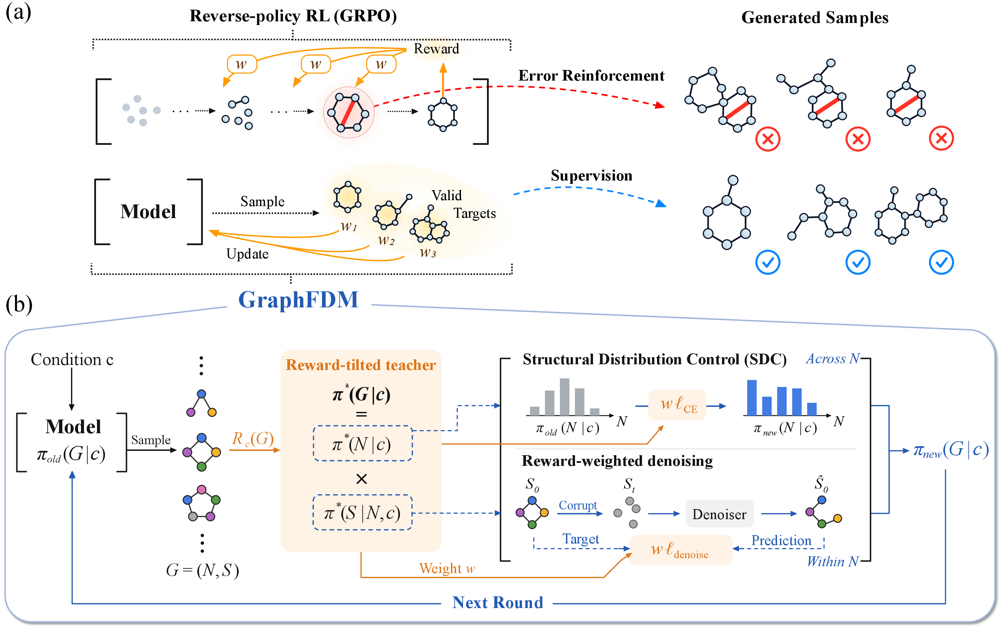

# GraphFDM

Official implementation of [Graph Forward Distribution Matching for Molecular Inverse Design](https://arxiv.org/abs/2609.32056).

GraphFDM converts terminal molecular feedback into a reward-tilted clean-graph distribution and learns it through the native forward-denoising objective, while Structural Distribution Control (SDC) learns its condition-dependent structural marginal.

<p align="center">
  <a href="Mainfig.pdf"></a>
</p>

## Installation

Create a Python 3.11 environment, install a CUDA-compatible PyTorch/PyG pair, and install the remaining dependencies:

```bash
python -m pip install -r requirements.txt
```

Paths are resolved relative to the repository or through two optional variables:

```bash
export GRAPHFDM_DATA_ROOT="$PWD/data"
export GRAPHFDM_OUTPUT_ROOT="$PWD/outputs"
```

Experiment tracking is disabled in the supplied configurations.

## Quick start

The following command downloads and verifies rQM9 v1, constructs a small deterministic dataset, trains lightweight property evaluators, and runs a reduced PT/SFT/GraphFDM pipeline:

```bash
./run_minimal.sh molecule
```

This smoke experiment checks the complete execution path; it is not the configuration used for the paper results. After providing the assets documented in [`data/polymer/README.md`](data/polymer/README.md), the corresponding polymer command is:

```bash
./run_minimal.sh polymer
```

## Paper experiments

Run data preparation and the three training stages separately:

```bash
./run_experiment.sh molecule prepare full
./run_experiment.sh molecule pt full
./run_experiment.sh molecule sft full
./run_experiment.sh molecule sdc full
```

Replace `molecule` with `polymer` for the polymer benchmark, or use `all` as the stage to execute the full pipeline. Formal hyperparameters are provided in `configs/`.

The molecule tokenizer and complete rQM9 preprocessing pipeline are included. Polymer data, tokenizer assets, and property evaluators are not redistributed; their required schema is documented in [`data/polymer/README.md`](data/polymer/README.md).

## Repository structure

```text
configs/                 PT, SFT, and GraphFDM configurations
graphfdm/                structured teacher, controller, and online update
datasets/                unconditional and conditional graph datasets
diffusion/, models/      motif-aware discrete graph diffusion backbone
tokenizer/               motif tokenizer implementation
assets/tokenizers/       included molecule tokenizer; polymer placeholder
scripts/                 data download and preprocessing
tests/                   lightweight core tests
run_experiment.sh         stage-aware experiment entry point
run_minimal.sh            reduced end-to-end entry point
```

## Citation

```bibtex
@article{zhu2026graphfdm,
  title   = {Graph Forward Distribution Matching for Molecular Inverse Design},
  author  = {Zhu, Yihan and Liu, Yuhan and Savoie, Brett and Luo, Tengfei and Jiang, Meng},
  journal = {arXiv preprint arXiv:2609.32056},
  year    = {2026}
}
```

## License

This repository is released under the [MIT License](LICENSE). Third-party packages, datasets, and externally sourced components remain subject to their respective terms.
